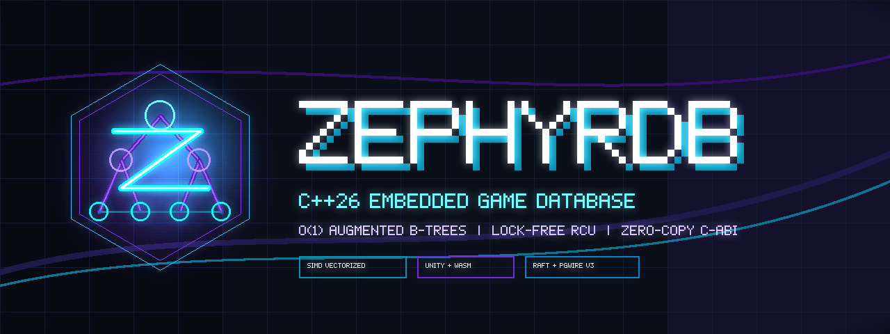
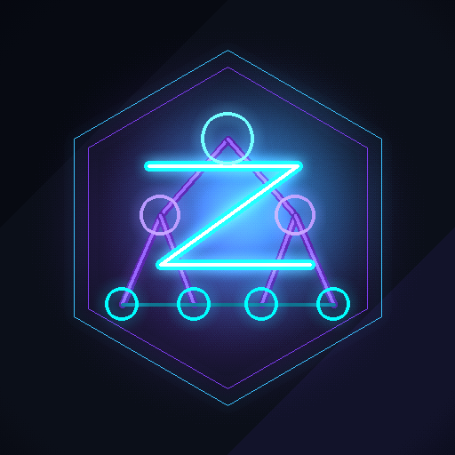
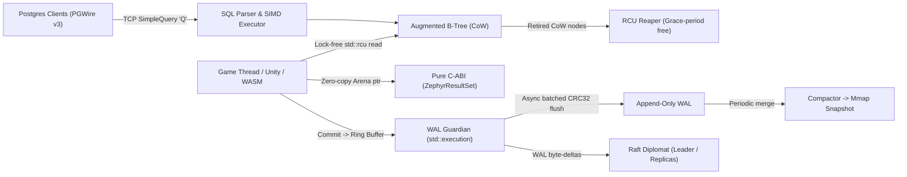

<p align="center">
  
</p>

<p align="center">
  
</p>

<h1 align="center">ZephyrDB</h1>

<p align="center">
  <strong>Hyper-lightweight, embeddable C++26 database engineered for zero-frame-drop game state, instant NPC memory, and MMORPG shards.</strong>
</p>

<p align="center">
  
  
  
  
  
</p>

---

## Why ZephyrDB?

Traditional embedded databases force game engines to choose between blocking disk I/O, heavy GC allocations across FFI boundaries, and full-table scans for simple math. **ZephyrDB** eliminates all three:

- **O(1) & O(log N) Augmented B-Trees:** Every node caches `COUNT`, `SUM(i64)`, `SUM(f64)`, `MIN`, and `MAX` metadata for up to 8 numeric columns. Queries like `SELECT COUNT(*), SUM(gold) FROM players` resolve directly from the root in nanoseconds without scanning rows.
- **Lock-Free Reads (`std::rcu`):** Copy-on-Write path updates atomically swap the tree root while readers traverse snapshots completely lock-free.
- **Vectorized Columnar Scans (`std::simd`):** Contiguous columnar blocks evaluated in 64-row chunks using AVX2 / WebAssembly `simd128` intrinsics.
- **Zero-Copy C-ABI (`extern "C"`):** Query results are packed into 64-byte aligned `Arena` slabs so Unity C# (`unsafe` / `ReadOnlySpan<byte>`), WebAssembly (`HEAPU8`), and Rust read cells in place with zero GC pressure.
- **Autonomous C++26 Agents (`std::execution`):** Background **WAL Guardian**, **RCU Reaper**, **Compactor**, and **Raft Diplomat** agents keep disk durability, memory reclamation, and cluster replication off your main game frame.
- **MMORPG & Tooling Ready:** Built-in **PostgreSQL Wire Protocol v3.0** TCP server (`psql`-compatible) and **Raft** WAL delta replication.

---

## Actor / Agent Architecture



See [AGENTS.md](AGENTS.md) for the full agent design and [PLAN.md](PLAN.md) for the five-phase roadmap.

---

## Measured Performance

Measured on Windows x64 (`MSVC 19.52`, `/std:c++latest /O2 /arch:AVX2`, `zephyrdb_bench.exe`):

| Benchmark | Measured Result | Notes |
| --- | --- | --- |
| **Arena Bump Allocation** (24 B, reset/16k) | **2.35 ns/op** | 64-byte aligned slab allocator |
| **Augmented B-Tree `O(1)` `COUNT` / `SUM`** (100k rows) | **6.28 ns/query** | Root metadata read (`ZEPHYR_FLAG_O1_FASTPATH`) |
| **Augmented B-Tree `O(log N)` `range_sum`** (50k-key range) | **145.61 ns/query** | Subtree aggregate pruning |
| **SIMD Columnar Filter** (`100k` `int64_t`) | **1,418.37 M rows/sec** | AVX2 4-wide 64-element bitmask chunks |
| **Lock-Free RCU Point Reads** (4 threads) | **112.62 M reads/sec** | Zero mutexes on read path |
| **SQL C-ABI `COUNT(*) + SUM(gold)` Roundtrip** | **3.00 µs/query** | Full SQL parse + O(1) exec + Arena pack |

---

## Quick Start

### 1. Build Native Core, Shared DLL, Tests & Benchmarks

```powershell
# Windows (Visual Studio 18 / MSVC 19.52+ with CMake & Ninja)
cmd /c "`"C:\Program Files\Microsoft Visual Studio\18\Community\VC\Auxiliary\Build\vcvars64.bat`" && cmake -B build -G Ninja -DCMAKE_BUILD_TYPE=Release && cmake --build build"

ctest --test-dir build --output-on-failure
.\build\zephyrdb_bench.exe
```

On Linux / macOS (GCC 15/16 or Clang 19+):

```bash
cmake -B build -G Ninja -DCMAKE_BUILD_TYPE=Release
cmake --build build
ctest --test-dir build --output-on-failure
```

### 2. C / C++26 Zero-Copy C-ABI

```c
#include "zephyr/c_abi.h"

ZephyrConfig cfg = zephyr_default_config();
cfg.data_dir = "./save_data";
ZephyrDB* db = zephyr_db_open(&cfg);

zephyr_exec(db, "CREATE TABLE players (id BIGINT PRIMARY KEY, name TEXT, gold BIGINT);", NULL);
zephyr_exec(db, "INSERT INTO players VALUES (1, 'Aria', 250), (2, 'Bram', 400);", NULL);

// Resolved in O(1) via Augmented B-Tree root metadata (ZEPHYR_FLAG_O1_FASTPATH)
ZephyrResultSet* res = zephyr_query(db, "SELECT COUNT(*), SUM(gold) FROM players;");
// res->values[0].as.i64 == 2, res->values[1].as.i64 == 650
zephyr_result_free(res);
zephyr_db_close(db);
```

### 3. Unity (C#) Zero-GC Bindings

Drop `zephyrdb.dll` (or `.so`/`.dylib`) into `Assets/Plugins/` alongside [bindings/unity/ZephyrNative.cs](bindings/unity/ZephyrNative.cs) and [bindings/unity/ZephyrDB.cs](bindings/unity/ZephyrDB.cs):

```csharp
using var db = ZephyrDatabase.Open("save_data");
db.Exec("CREATE TABLE npcs (id BIGINT PRIMARY KEY, name TEXT, hp DOUBLE PRECISION);");
db.Exec("INSERT INTO npcs VALUES (1, 'Guard', 100.5);");

using var res = db.Query("SELECT id, name, hp FROM npcs ORDER BY id;");
var row = res.GetRow(0);
long id = row.GetInt64(0);
ReadOnlySpan<byte> utf8Name = row.GetUtf8Span(1); // Zero heap allocations!
```

Verify the C# struct layouts and live P/Invoke roundtrip with .NET:

```powershell
$env:PATH = "$PWD\build;$env:PATH"
dotnet run -c Release --project bindings/unity/ZephyrDB.Tests
```

### 4. WebAssembly (Three.js / SolidJS) & Rust

```powershell
# Compile to WASM with -std=c++26 -msimd128 -mrelaxed-simd
.\bindings\wasm\build_wasm.ps1
```

- TypeScript linear-memory wrapper: [bindings/wasm/zephyrdb.ts](bindings/wasm/zephyrdb.ts)
- Rust FFI crate: [bindings/rust/src/lib.rs](bindings/rust/src/lib.rs) (`cargo check --manifest-path bindings/rust/Cargo.toml`)

### 5. Standalone Server (PGWire v3.0 + Raft Diplomat)

```powershell
.\build\zephyrdb_server.exe --data-dir ./shard_1 --pgwire-port 5432 --raft-id 1 --raft-port 7001 --peers "1@127.0.0.1:7001,2@127.0.0.1:7002"
```

Connect with any PostgreSQL client (`psql -h 127.0.0.1 -p 5432 -U postgres`).

---

## Architecture & Specifications

| Document | Description |
| --- | --- |
| [docs/abi.md](docs/abi.md) | Zero-copy C-ABI `extern "C"` signatures, byte offsets (`x64` & `wasm32`), Arena slab packing, and Unity C# `unsafe` patterns |
| [docs/toolchain.md](docs/toolchain.md) | C++26 compiler flags (GCC 15/16, Clang 19+, MSVC 19.52+, Emscripten), `compat/cpp26.hpp` bridge, and socket linking |
| [docs/ast.md](docs/ast.md) | Bounded PostgreSQL syntax subset, EBNF grammar (`WITH`, `JOIN`, `RETURNING`), and `O(1)`/`O(log N)` pushdown rules |
| [AGENTS.md](AGENTS.md) | Internal C++26 Actor/Agent architecture & AI/NPC local memory store design |
| [PLAN.md](PLAN.md) | 5-phase engineering roadmap |

---

## License

Released under the [MIT License](LICENSE).
