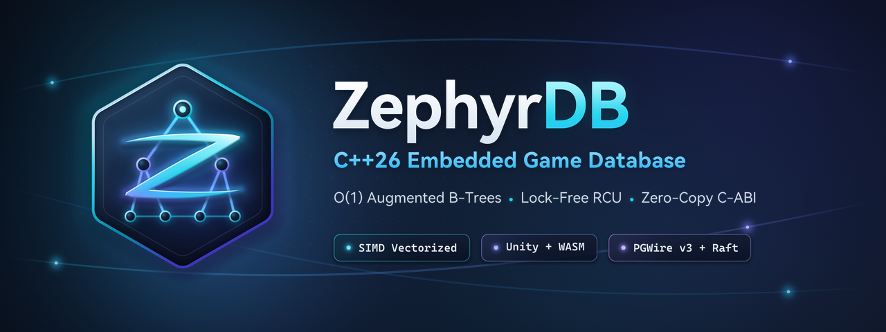
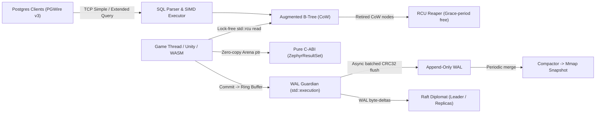

  

<h1 align="center">ZephyrDB</h1>

  <strong>Hyper-lightweight, embeddable C++26 database engineered for zero-frame-drop game state, instant NPC memory, and MMORPG shards.</strong>

---

## Why ZephyrDB?

Traditional embedded databases force game engines and real-time backends to trade off between blocking disk I/O, GC allocations across FFI boundaries, and full-table scans for simple aggregate queries. **ZephyrDB** eliminates all three:

| Capability | Mechanism | Benefit |
| :--- | :--- | :--- |
| **O(1) & O(log N) Aggregates** | Augmented CoW B+Tree (`COUNT`, `SUM`, `MIN`, `MAX` cached per node) | `SELECT COUNT(*), SUM(gold)` resolves from the root in nanoseconds |
| **Lock-Free Reads** | `std::rcu` (`zephyr::cpp26::rcu`) snapshot traversal | Zero mutexes on the read path; 112M+ reads/sec across threads |
| **Vectorized Columnar Scans** | `std::simd` / AVX2 / WASM `simd128` 64-element bitmask chunks | 1.4B+ rows/sec predicate filtering |
| **Zero-Copy C-ABI** | 64-byte aligned `Arena` slabs (`ZephyrResultSet`) | Unity `ReadOnlySpan<byte>`, WASM `HEAPU8`, and Rust read in place with zero GC |
| **Autonomous C++26 Agents** | `std::execution` background **WAL Guardian**, **RCU Reaper**, **Compactor**, **Raft Diplomat** | Disk durability, memory reclamation, and replication stay off the main thread |
| **Postgres Wire + Raft** | PGWire v3.0 TCP server + UDP/TCP WAL delta replication | Connect with `psql`, `node-postgres`, or `ZephyrPgClient` |

---

## Actor / Agent Architecture

ZephyrDB avoids a monolithic blocking server model by delegating background I/O, memory reclamation, compaction, and cluster consensus to autonomous C++26 agents:

---

## Explore the Documentation

  <a class="zephyr-card" href="#/getting-started">
    <h3>Getting Started</h3>
    
Build with CMake + Ninja on Windows, Linux, or macOS, run prepared C-ABI queries, and launch <code>zephyrdb_server</code>.

  </a>
  <a class="zephyr-card" href="#/sql-guide">
    <h3>SQL Guide</h3>
    
Practical PostgreSQL syntax: <code>WITH</code> CTEs, <code>JOIN</code>, <code>INSERT ... RETURNING</code>, <code>$1</code> params, and O(1) aggregates.

  </a>
  <a class="zephyr-card" href="#/node-backend">
    <h3>Node.js Backend</h3>
    
Connect web backends via <code>ZephyrPgClient</code>, <code>node-postgres</code>, or embedded N-API bindings.

  </a>
  <a class="zephyr-card" href="#/unity-guide">
    <h3>Unity C# Guide</h3>
    
Zero-GC frame-safe queries using <code>ZephyrDatabase</code>, <code>ReadOnlySpan&lt;byte&gt;</code>, and <code>ZephyrNative.cs</code>.

  </a>
  <a class="zephyr-card" href="#/wasm-guide">
    <h3>WebAssembly &amp; Three.js</h3>
    
Compile with Emscripten (<code>-std=c++26 -msimd128</code>) and query linear memory via <code>zephyrdb.ts</code>.

  </a>
  <a class="zephyr-card" href="#/performance">
    <h3>Performance &amp; Benchmarks</h3>
    
Deep dive into Augmented B-Trees, RCU, AVX2 SIMD, Node Pools, and measured numbers.

  </a>
  <a class="zephyr-card" href="#/abi">
    <h3>Zero-Copy C-ABI Spec</h3>
    
Exact <code>extern "C"</code> signatures, <code>x64</code>/<code>wasm32</code> byte offsets, and Arena slab packing.

  </a>
  <a class="zephyr-card" href="#/ast">
    <h3>Postgres AST &amp; Grammar</h3>
    
Bounded keyword table, EBNF grammar, and <code>O(1)</code>/<code>O(log N)</code> pushdown rules.

  </a>
  <a class="zephyr-card" href="#/toolchain">
    <h3>C++26 Toolchain</h3>
    
Compiler flags for GCC 15/16, Clang 19+, MSVC 19.52+, Emscripten, and <code>cpp26.hpp</code> fallbacks.

  </a>

